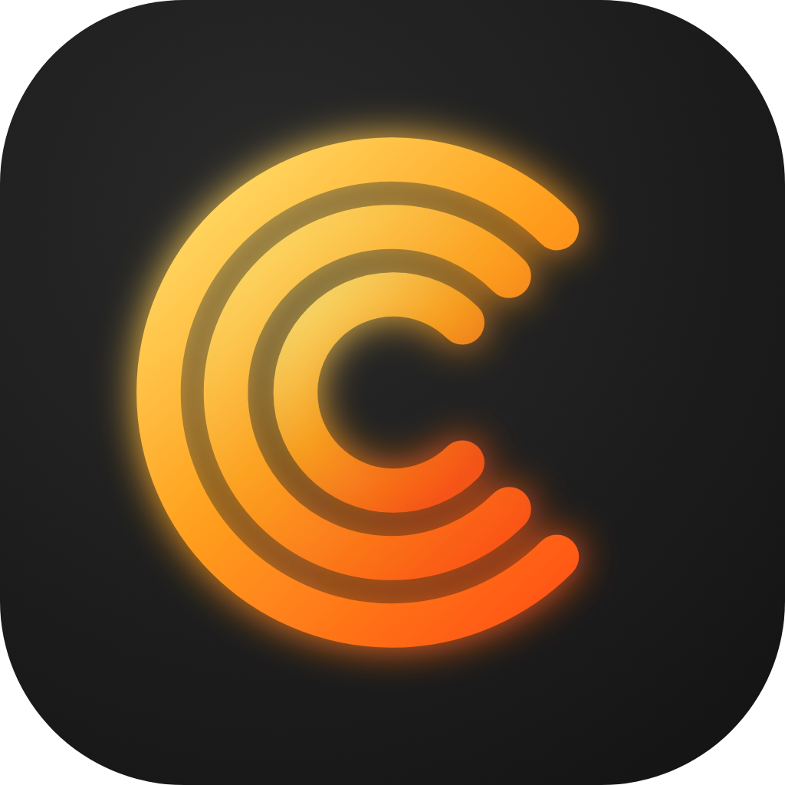
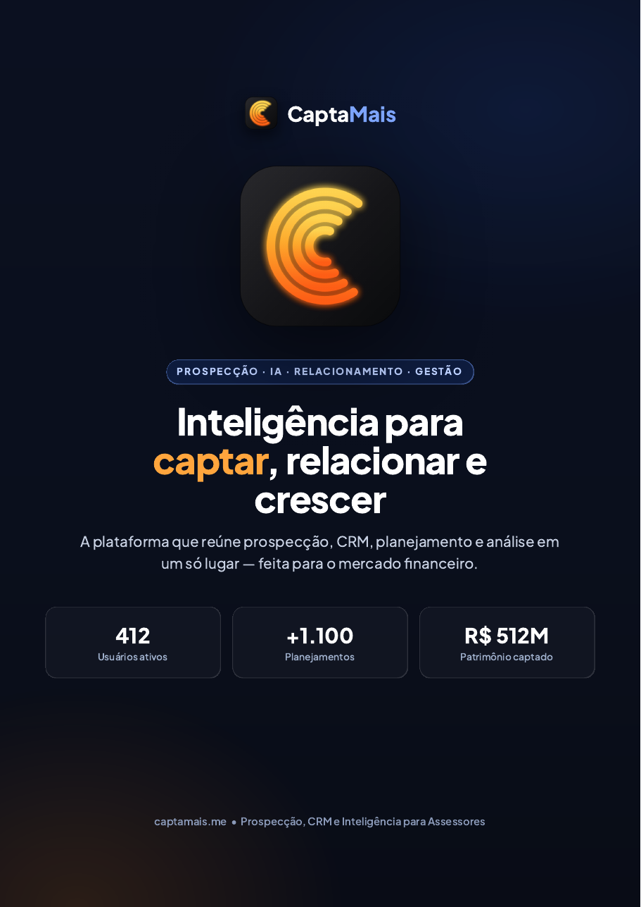
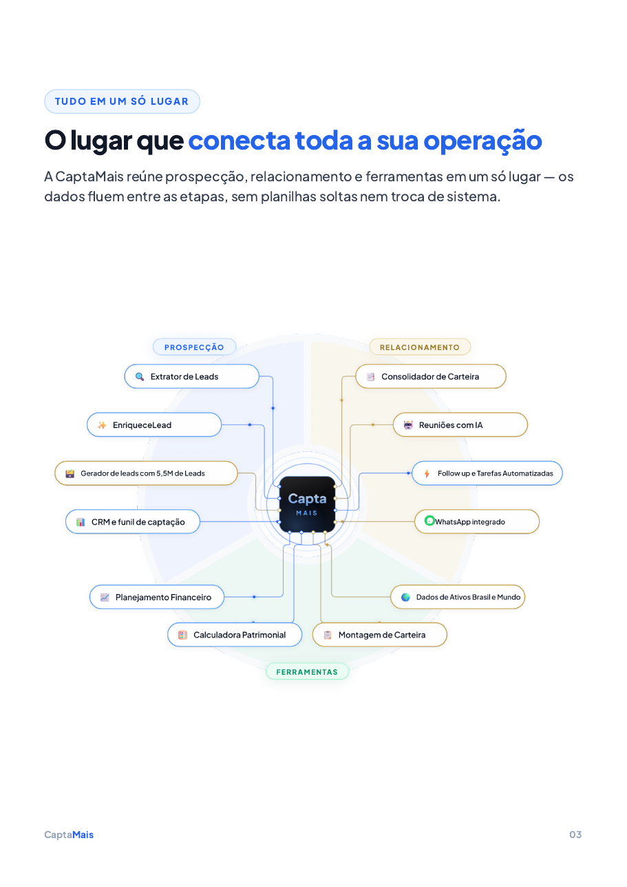
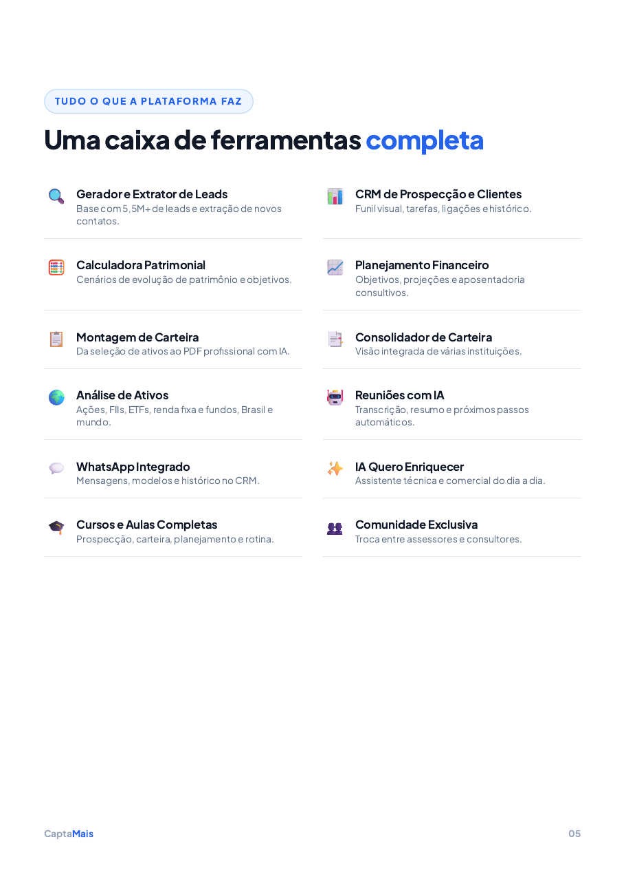

<p align="center">
  
</p>

<h1 align="center">CaptaMais local — Skill e MCP</h1>

<p align="center">
  <strong>Seu CRM de prospecção no seu computador.</strong><br>
  Uma solução da <strong>Capita+®</strong> para usar com Claude, Cursor e outros assistentes.
</p>

<p align="center">
  <a href="https://captamais.me"><strong>Conhecer a plataforma</strong></a> ·
  <a href="docs/apresentacao-capta-mais.pdf"><strong>Abrir apresentação</strong></a> ·
  <a href="https://github.com/Tasca2/captamais-local/raw/main/docs/apresentacao-capta-mais.pdf"><strong>Baixar PDF</strong></a>
</p>

<p align="center">
  <a href="https://github.com/Tasca2/captamais-local/releases/latest"></a>
  <a href="https://github.com/Tasca2/captamais-local/releases"></a>
  <a href="https://github.com/Tasca2/captamais-local/releases/latest"><strong>⬇️ Baixar a última versão</strong></a>
</p>

**Versão 1.14** (metadados npm: `1.0.14`).

Os dados dos seus leads ficam **na sua máquina**. Recursos de IA (opcional) passam pela nuvem [CaptaMais](https://captamais.me) e seguem as políticas oficiais da plataforma.

| Pasta | Para quê |
|---|---|
| [`captamais-skill/`](captamais-skill/) | Skill do Claude (`/captamais`) — funil, leads, agenda |
| [`captamais-mcp/`](captamais-mcp/) | Servidor MCP — Cursor, Claude Desktop e outros clientes |

## Conheça o ecossistema CaptaMais

Da prospecção ao relacionamento e às ferramentas de apoio, o CaptaMais conecta a operação comercial
em um só lugar. Veja alguns destaques da apresentação institucional:

<p align="center">
  <a href="docs/apresentacao-capta-mais.pdf"></a>
  <a href="docs/apresentacao-capta-mais.pdf"></a>
  <a href="docs/apresentacao-capta-mais.pdf"></a>
</p>

<p align="center">
  <a href="docs/apresentacao-capta-mais.pdf"><strong>📖 Abrir a apresentação completa</strong></a> ·
  <a href="https://github.com/Tasca2/captamais-local/raw/main/docs/apresentacao-capta-mais.pdf"><strong>⬇️ Baixar em PDF</strong></a>
</p>

**Copyright © 2026 Henrique Tasca Tedesco.** Todos os direitos reservados.  
Capita+® é uma marca registrada. CaptaMais — [captamais.me](https://captamais.me)

---

## Antes de começar

1. Conta no [CaptaMais](https://captamais.me) (para vincular a nuvem; o CRM local funciona sem isso).
2. Nada de Node.js para instalar à mão: se o seu computador não tiver o Node.js 18+, a skill baixa um Node portátil oficial para dentro da própria pasta (sem instalar nada no sistema nem mexer no PATH).
3. Claude Desktop (skill) e/ou Cursor / outro cliente MCP.

Ao usar a nuvem CaptaMais, você concorda com:

- [Termos de uso](https://captamais.me/termos)
- [Política de privacidade (LGPD)](https://captamais.me/privacidade)
- [Acordo de tratamento de dados — DPA](https://captamais.me/dpa)

No CRM só local, os leads não saem do seu PC. Veja também a [privacidade desta skill](captamais-skill/PRIVACY.md).

---

## Jeito mais rápido: peça ao Claude

Cole no Claude **instalado no seu computador** (Claude Desktop ou Claude Code; em sessões na nuvem não funciona):

```
Instale a skill CaptaMais deste repositório e abra o CRM quando terminar:
https://github.com/Tasca2/captamais-local
```

O Claude baixa o repositório, copia a skill para a pasta de skills, baixa o Node.js portátil se o computador não tiver,
prepara as dependências, cria o ícone "CaptaMais" na Área de Trabalho e já abre o CRM. Se preferir fazer à mão, siga os passos abaixo.

---

## 1. Baixar

**Jeito mais simples (sem Git):**

1. Abra a página de [**Releases**](https://github.com/Tasca2/captamais-local/releases/latest).
2. Em **Assets**, baixe **`captamais-completo-vX.XX.zip`**: skill e MCP juntos, no mesmo arquivo.
   (Se quiser só uma parte, há também `captamais-skill-vX.XX.zip` e `captamais-mcp-vX.X.X.zip`.)
3. Extraia o ZIP, por exemplo em `Documentos\CaptaMais-local`.
4. Dentro dela você verá `captamais-skill` e `captamais-mcp`.

> Prefira os arquivos da Release ao botão **Code → Download ZIP**: eles são a versão oficial, enxuta, e são os únicos cujos downloads são contados.

**Quem usa Git:**

```powershell
git clone https://github.com/Tasca2/captamais-local.git
```

---

## 2. Instalar a skill (Claude)

No PowerShell (Windows), ajuste o caminho se você extraiu o ZIP em outro lugar:

```powershell
$origem  = "$env:USERPROFILE\Documents\CaptaMais-local\captamais-skill"
$destino = "$env:USERPROFILE\.claude\skills\captamais"
New-Item -ItemType Directory -Force -Path $destino | Out-Null
Copy-Item -Recurse -Force "$origem\*" $destino      # copia o CONTEÚDO (não cria pasta dentro de pasta)
Set-Location $destino
npm install
Test-Path "$destino\SKILL.md"                       # precisa mostrar True
```

No Mac / Linux:

```bash
mkdir -p ~/.claude/skills/captamais
cp -R captamais-skill/. ~/.claude/skills/captamais/   # copia o CONTEÚDO (não cria pasta dentro de pasta)
cd ~/.claude/skills/captamais
npm install
ls SKILL.md                                           # precisa existir aqui
```

**Feche e abra o Claude Code de novo** — o comando `/captamais` só aparece em uma sessão nova. Depois peça **"abrir o Capta+"** ou digite `/captamais`.

> A skill funciona no **Claude Code** (terminal ou aba **Code** do app Claude Desktop), que lê a pasta `.claude/skills` do seu computador.
> Ela **não** aparece no chat comum do Claude nem em sessões na nuvem — nesses casos use o ícone **CaptaMais** da Área de Trabalho.

### O /captamais não aparece?
1. **Feche e abra o Claude Code** (ou inicie uma sessão nova): skills instaladas durante uma conversa só são lidas ao iniciar.
2. Digite `/` e procure **captamais** na lista. Se não estiver, siga os passos abaixo.
3. Confira que existe **exatamente** `.claude/skills/captamais/SKILL.md` (Windows: `%USERPROFILE%\.claude\skills\captamais\SKILL.md`). Se o arquivo estiver em `captamais/captamais-skill/SKILL.md`, a pasta foi copiada aninhada: mova o conteúdo de `captamais-skill` para a pasta `captamais`.
4. Confirme que está no **Claude Code** no seu computador (não no chat comum nem na nuvem).
5. Enquanto isso, o ícone **CaptaMais** (Área de Trabalho ou busca do Windows) abre o CRM normalmente.

---

## 3. Instalar o MCP (Cursor ou Claude Desktop)

No PowerShell, na pasta extraída:

```powershell
cd captamais-mcp
npm install
npm run build
```

Anote o caminho completo de `dist\index.js` (exemplo: `C:\Users\SeuNome\Documents\CaptaMais-local\captamais-mcp\dist\index.js`).

### Vincular sua conta CaptaMais

1. Entre em [captamais.me](https://captamais.me) e faça login.
2. Abra **Minha Conta → Conector**.
3. Gere a chave e copie (ela aparece **uma vez**).
4. Cole no cliente, como abaixo. **Não compartilhe essa chave.**

### Cursor

Em **Settings → MCP**, adicione um servidor:

- comando: `node`
- argumento: o caminho de `dist\index.js`
- variáveis:
  - `CAPTAMAIS_API_KEY` = sua chave
  - `CAPTAMAIS_CLOUD_URL` = `https://captamais.me`

### Claude Desktop

Edite o arquivo de configuração MCP e inclua:

```json
{
  "mcpServers": {
    "captamais": {
      "command": "node",
      "args": ["C:/Users/SeuNome/Documents/CaptaMais-local/captamais-mcp/dist/index.js"],
      "env": {
        "CAPTAMAIS_API_KEY": "cole-sua-chave-aqui",
        "CAPTAMAIS_CLOUD_URL": "https://captamais.me"
      }
    }
  }
}
```

Reinicie o cliente. Sem a chave, o CRM local funciona; só a IA da nuvem fica indisponível.

---

## Políticas, privacidade e LGPD

O CaptaMais trata dados em dois papéis, descritos na política oficial:

| Situação | Papel |
|---|---|
| Seu cadastro, login e uso da plataforma | CaptaMais é **controlador** |
| Leads e clientes que você cadastra | **Você** é o controlador; o CaptaMais só opera na nuvem quando você pede um recurso (IA, etc.) |

Documentos oficiais (fonte única, versão vigente no site):

| Documento | URL |
|---|---|
| Termos de uso | https://captamais.me/termos |
| Política de privacidade (LGPD) | https://captamais.me/privacidade |
| Acordo de tratamento de dados (DPA) | https://captamais.me/dpa |

Textos complementares deste repositório (skill local): [PRIVACY.md](captamais-skill/PRIVACY.md), [DISCLAIMER.md](captamais-skill/DISCLAIMER.md), [SECURITY.md](captamais-skill/SECURITY.md). Em caso de divergência, **valem os documentos do site**.

Encarregado / contato: [contato@henriquetasca.com.br](mailto:contato@henriquetasca.com.br)

---

## Direitos autorais

```
Copyright © 2026 Henrique Tasca Tedesco.
CaptaMais — https://captamais.me
Todos os direitos reservados.
```

O código deste repositório é **source-available**: você pode baixar e usar na sua máquina. Não pode republicar, revender nem usar para copiar a plataforma. Licença completa: [LICENSE](LICENSE).

Capita+® é uma marca registrada de Henrique Tasca Tedesco. A marca, a identidade visual e a
plataforma CaptaMais pertencem a Henrique Tasca Tedesco.

---

## Suporte

- Plataforma e conta: [captamais.me](https://captamais.me)
- E-mail: [contato@henriquetasca.com.br](mailto:contato@henriquetasca.com.br)
- Falha de segurança: não abra issue pública — escreva para o e-mail acima (veja [SECURITY.md](captamais-skill/SECURITY.md)).
